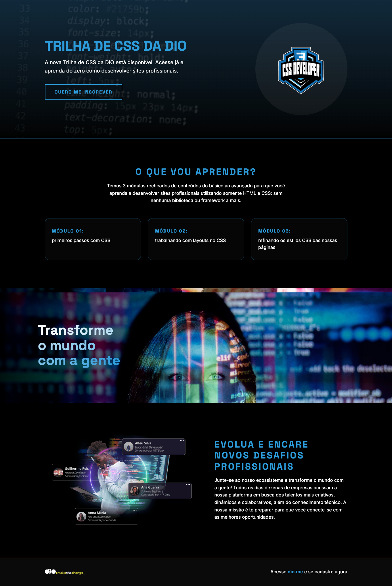
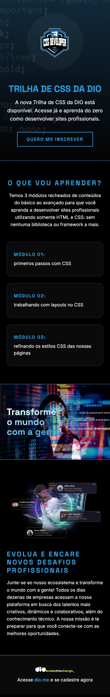

# 🎨 TRILHA DE CSS DA DIO — DESAFIO 01

> [!NOTE]
> **Minha primeira landing page só com HTML e CSS:** desafio da Trilha de CSS da [DIO](https://www.dio.me). O HTML e as imagens vieram prontos, e eu fiz toda a estilização. Não segui o modelo ao pé da letra: criei uma versão minha, com outras fontes, layout em colunas e cards, texto em degradê, efeito parallax e versão para celular.

A página divulga a Trilha de CSS e tem cinco partes: banner com chamada e logo, os 3 módulos do curso, uma faixa com foto ("Transforme o mundo com a gente"), uma seção sobre desafios profissionais e o rodapé.

---

## 🎓 Sobre o Projeto

Este é o primeiro desafio da Trilha de CSS da DIO. A proposta era ligar o CSS ao HTML e estilizar a página usando os fundamentos da trilha: propriedades básicas, unidades relativas e absolutas e texto em degradê com `background-clip`.

O [modelo original](https://micheleambrosio.github.io/dio-trilha-css-desafio-01/) deixa tudo centralizado, um bloco embaixo do outro. Na minha versão eu quis um layout **menos empilhado**: banner e desafios em duas colunas (em zigue-zague), módulos em cards lado a lado e uma identidade própria com **Space Grotesk** nos títulos e **Inter** no texto, mantendo o azul da DIO.

### 🤖 Feito com IA

Fiz o projeto com o **Claude Code** (Anthropic) como professor. Eu escrevi o CSS e a IA explicou cada passo, revisou o código e sugeriu melhorias. O trabalho foi dividido em passos pequenos, um por seção, e cada um só avançava depois de eu testar no navegador, entender e fazer o commit.

---

## 🌐 Demonstração

- **Página no ar:** [https://eilincoln.github.io/trilha-css-desafio-01/](https://eilincoln.github.io/trilha-css-desafio-01/)

<div align="center">
  <table>
    <tr>
      <td align="center" width="65%">
        <b>💻 Desktop</b><br><br>
        
      </td>
      <td align="center" width="35%">
        <b>📱 Celular</b><br><br>
        
      </td>
    </tr>
  </table>
</div>

---

## 🧩 Seções da Página

| Seção                      | Como ficou                                                               | O que pratiquei                                                      |
| -------------------------- | ------------------------------------------------------------------------ | -------------------------------------------------------------------- |
| **Banner**                 | Texto à esquerda, logo num círculo à direita, fundo com imagem + degradê | Flexbox, múltiplos fundos, `aspect-ratio`, hover no botão            |
| **O que vou aprender?**    | 3 módulos em cards lado a lado que sobem no hover                        | `flex: 1`, `gap`, `transform`, `transition`                          |
| **Transforme o mundo**     | Faixa com foto, sombra em degradê e texto em degradê branco → azul       | `background-clip: text`, parallax com `background-attachment: fixed` |
| **Desafios profissionais** | Imagem à esquerda e texto à direita (zigue-zague com o banner)           | Flexbox com imagem em 50%                                            |
| **Rodapé**                 | Logo e link lado a lado, borda azul no topo                              | `justify-content: space-between`, estados do link                    |

---

## 🚀 Decisões de CSS

- **Só HTML + CSS:** sem framework e sem JavaScript. As fontes vêm do Google Fonts.
- **Variável de cor:** o azul fica em `--azul: #2d9cdb` no `:root` e é usado no site todo.
- **Reset simples:** `margin` e `padding` zerados e `box-sizing: border-box` em tudo.
- **Conteúdo com largura máxima:** as seções usam `max-width: 1100px` com `margin: 0 auto`, então o layout não se espalha em telas grandes.
- **Texto em degradê:** o degradê fica num `<span>` dentro do `<p>`, com `background-clip: text` e `-webkit-background-clip: text` para funcionar em mais navegadores.
- **Imagem otimizada:** a foto da faixa tinha 22 MB em PNG. Convertida para JPG, ficou com 878 KB sem perda visível.
- **Responsivo:** com `@media (max-width: 768px)` as colunas viram uma só (`flex-direction: column`), o banner mostra o logo em cima (`column-reverse`), as fontes diminuem e o parallax desliga, porque o `fixed` falha em muitos celulares.
- **Acessibilidade:** com `prefers-reduced-motion`, o parallax, as transições e o movimento dos cards são desligados para quem pede menos animação no sistema. Todas as imagens têm `alt`.

---

## 🗂️ Estrutura

```
index.html            estrutura da página (veio pronta, só reorganizei banner, faixa e desafios)
css/style.css         todo o estilo, separado por seção, com o responsivo no final
assets/images/        logo, banner, fotos e logo da DIO
docs/readme/          prints usados neste README
```

---

## 🛠️ Como Mexer

- **Rodar local:** é só abrir o `index.html` no navegador. Não tem build nem dependência.
- **Trocar a cor principal:** mudar `--azul` no começo do `css/style.css`.
- **Ajustar o celular:** as regras ficam no bloco `/* RESPONSIVO */`, no fim do CSS.
- **Publicar:** o site sai pelo GitHub Pages, a partir da branch `main`. Cada `git push` atualiza a página.

---

## 👨‍💻 Autor

Desenvolvido por **Lincoln Berto**.

- **LinkedIn:** [https://www.linkedin.com/in/lincoln-berto/](https://www.linkedin.com/in/lincoln-berto/)
- **GitHub:** [https://github.com/eilincoln](https://github.com/eilincoln)
- **Portfólio:** [https://www.lincolnberto.com](https://www.lincolnberto.com)
